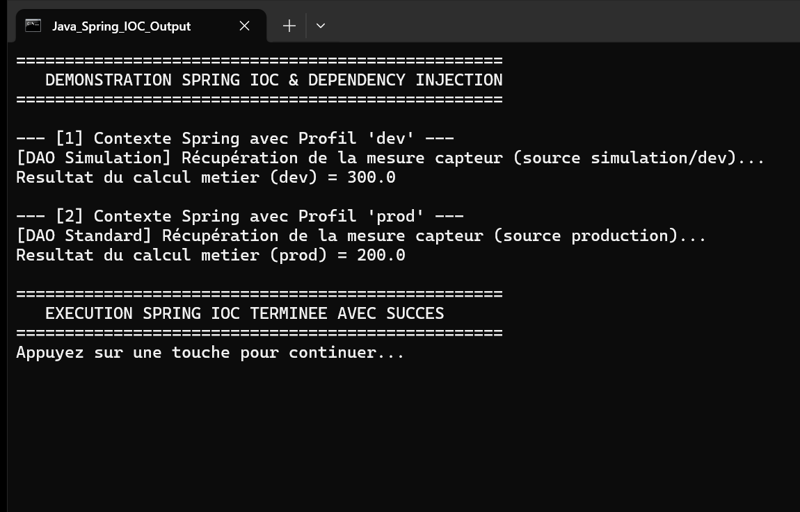

# TP 2 : Inversion de Controle (IoC) et Injection de Dependances avec Spring

Ce projet illustre la mise en oeuvre de l'Inversion de Controle (IoC) et de l'Injection de Dependances (DI) en utilisant le framework Spring (version 6.1.2) sur un environnement Java 17.

## Architecture du Projet

Le projet suit une separation en couches respectant le principe de responsabilite unique et l'inversion des dependances :

- `dao.IDao` : Interface definissant le contrat d'acces aux donnees.
- `dao.DaoImpl` : Implementation standard destinee a la production (activee sous le profil `prod`).
- `dao.DaoImpl2` : Implementation simulee destinee au developpement et aux tests (activee sous le profil `dev`).
- `metier.IMetier` : Interface definissant les services de calcul metier.
- `metier.MetierImpl` : Service metier recevant l'instance de `IDao` via injection de dependance par constructeur / annotation `@Autowired`.
- `presentation.Presentation2` : Classe de configuration et point d'entree executant l'application sous differents profils Spring via `AnnotationConfigApplicationContext`.
- `applicationContext.xml` : Fichier de configuration XML alternatif demontrant le cablage manuel des beans via `ClassPathXmlApplicationContext`.
- `metier.MetierImplTest` : Test unitaire JUnit validant la logique metier avec un bouchon (stub).

## Resultat d'Execution

L'application a ete executee directement en ligne de commande Java afin de valider le bon fonctionnement de l'injection et la resolution contextuelle des profils.

La capture d'ecran de la console ci-dessous illustre le resultat reel de l'execution de l'application :

### Description de la Capture

La console affiche le deroulement complet des operations :
1. Initialisation du contexte Spring avec le profil `dev` : resolution automatique du bean `DaoImpl2` et affichage du resultat metier associe (150.0 * 2 = 300.0).
2. Initialisation du contexte Spring avec le profil `prod` : resolution automatique du bean `DaoImpl` et affichage du resultat metier associe (100.0 * 2 = 200.0).
3. Cloture controlee des contextes applicatifs et confirmation de reussite.
